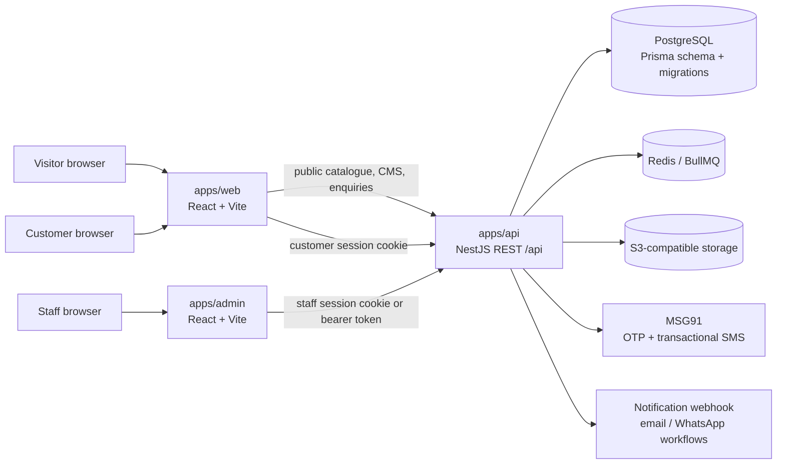

# System design

**Status:** Describes the current repository and identifies the next design improvements. Verify deployment-specific values against the target environment before release.  
**Product baseline:** [PRD](../product/PRD.md)  
**Repository conventions:** [Code structure](code-structure.md)

## 1. System context

Material Square is a single-seller construction-materials marketplace with a separate staff operations workspace. The customer site and admin site are browser applications; both call a NestJS REST API. The API owns authorization and business rules and persists operational records in PostgreSQL through Prisma.

The diagram describes configured integration boundaries, not proof that every provider is configured or production-verified. See [production readiness](../operations/production-readiness.md).

Provider status: customer OTP currently uses MSG91. The planned direction is to move OTP and future customer notifications/reminders to Wa Bridge; that integration is not implemented. Existing notification queue, MSG91 SMS, and webhook code is retained but delivery rollout and QA are deferred. Keep this distinction visible in release notes and environment setup.

## 2. Repository boundaries

| Path | Responsibility | Current integration |
| --- | --- | --- |
| `apps/web` | Public catalogue, product detail, content pages, browser material list, customer account | React Router; public/customer REST calls to `/api` |
| `apps/admin` | Staff authentication and operational workspace | Protected routes; staff API wrapper; feature screens for sales, catalogue, CMS and business operations |
| `apps/api` | REST boundary, authentication, validation, business operations, jobs, media and reports | Nest modules/controllers; Prisma; Redis/BullMQ; S3-compatible storage; external notification providers |
| `packages/db` | Prisma schema, generated client and ordered SQL migrations | PostgreSQL source of truth |
| `packages/types` | Shared runtime schemas, domain types, copy and catalogue helpers | Imported by web/admin/API; package build must precede consuming builds |
| `packages/storefront-ui` | Presentational storefront components reused in the admin preview | Shared source imported by both web and admin |
| `deployment`, `scripts`, `.github` | Container/host configuration, local runtime, migrations, staff provisioning, CI | Deploy jobs and scripts must follow the migration-before-API rule |

The source tree is organized mostly by application and feature. The API has Nest modules for auth, products, quotes, orders, RFQs, storage, jobs, analytics, reports, audit, workspace and business capabilities. Some `business` controllers still coordinate Prisma reads/writes directly; service extraction is a gradual consistency improvement, not a current universal rule.

## 3. Runtime and request flows

### 3.1 Customer catalogue

1. `apps/web` loads the public catalogue from `GET /api/products` and normalizes category display values with shared helpers.
2. `ProductsController` delegates public queries to `ProductsService`; public results are derived from published, non-deleted catalogue records.
3. `ProductsService` maps Prisma catalogue listings and variants into a storefront response, including availability, prices, offers and images.
4. The browser keeps catalogue state for search, filters, product detail and the material list. The quote list is browser-local until request submission.

The customer browser must never be treated as an authorization boundary for private information. Public response shaping belongs at the API boundary.

### 3.2 Customer request and account

1. The browser completes the configured phone-verification flow and sends the provider token to the API.
2. The API validates provider proof, resolves the customer, and issues an HTTP-only customer session cookie. The browser uses cookie credentials for account calls.
3. The API obtains the customer identity from the session and filters account reads by that identity.
4. An RFQ is stored with the customer link and canonical item snapshot. Staff access it through the protected RFQ API.
5. Customer quotation responses are validated and claimed conditionally in a transaction before downstream order/procurement effects are created.

### 3.3 Staff quotation and fulfilment

1. Staff authenticate through the admin workspace and receive a protected staff cookie. The notification status screen also sends its staff credential in an `Authorization: Bearer` header.
2. API guards resolve the staff identity and check role/permission rules. UI visibility is convenience only; API checks are authoritative.
3. Sales staff read RFQs, catalogue options and inventory, then create or revise quotation drafts through the API.
4. Publishing makes the quotation customer-visible and may enqueue a configured notification.
5. Acceptance creates operational order/procurement work according to the transaction path; sourcing, dispatch and offline receipt remain internal staff workflows.
6. Audit and notification records provide operational history. Provider acceptance is not equivalent to end-user message delivery.

### 3.4 Staff catalogue publication

Catalogue edits are submitted to the API, validated with bounded schemas, and persisted to the catalogue listing/variant tables. Draft preview is a staff workflow. Public catalogue/search/sitemap code must select published records only. Media upload is authorized by the API and stored through the S3-compatible storage adapter.

### 3.5 Background and external work

The API uses Redis/BullMQ for scheduled or queued work. Jobs read/write domain records and create notification outbox entries before provider delivery. The outbox must be the durable state boundary; retries should not create duplicate customer-visible side effects. S3 object access should stay behind the storage service, particularly for private RFQ attachments.

## 4. Data ownership

Prisma models define the persistence graph. The primary business relationships include:

- `Customer` → `Rfq` → `Quotation` → quotation items/options → `Order` → order items/deliveries.
- `CatalogListing` → `CatalogListingVariant`; quotation items snapshot catalogue identity and selected commercial details.
- `Supplier` → `SupplierProduct` / `SupplierQuote` → `ProcurementRequest` / `PurchaseOrder`.
- `StaffUser` → audit records, manual payment records, assignments and staff-authored content changes.
- `WebsiteContent` and revisions, `MediaAsset`, `BlogPost`, and `ExpertAdvisor` support the managed site.
- `NotificationOutbox`, queue workers, loyalty ledger, commissions and audit history support operational processes.

Database migrations are the schema deployment contract. API deployment must wait for required migrations to finish. Never use catalogue seeds as a production inventory source. See the root README and [starter-catalogue policy](../product/starter-catalogue.md).

## 5. API and browser contracts

- API prefix: `/api`; Nest configures CORS, origin checks, security headers, rate limiting, exception normalization and input validation in the application bootstrap.
- Staff and customer sessions are separate trust domains. Customer requests use an HTTP-only cookie; admin requests use the staff session cookie, with the notification status screen using its staff bearer token in an `Authorization` header. Customer ownership checks and staff permission checks are performed server-side.
- The API exposes Swagger/OpenAPI in development and optionally in production. Browser request shapes are currently maintained in application code as TypeScript types; the exact level of generated contract sharing should be evaluated before adding more endpoints.
- Staff list endpoints are being migrated to bounded page responses. Some endpoints still preserve an array response when no page query is supplied for compatibility. New list endpoints should have an explicit, documented pagination contract and deterministic sort order.
- Public storefront APIs and staff APIs are separate authorization surfaces even when they read the same catalogue tables.

## 6. Security and reliability boundaries

1. **Authentication:** provider OTP validates customer phone ownership; staff password authentication is separate. Session cookies are HTTP-only and server-issued.
2. **Authorization:** API guards and permission functions protect staff routes; customer routes scope every query to the session customer.
3. **Input:** use bounded Zod/DTO schemas for request bodies and query strings; validate IDs and state transitions at the API boundary.
4. **Network:** production CORS origins and trusted proxies are explicit. Forwarded client IP headers are not trusted by default.
5. **Abuse:** public endpoints use shared PostgreSQL-backed rate-limit buckets; limits, database availability behavior and proxy configuration require production validation.
6. **Files:** private attachment reads require parent-record authorization; media storage credentials never reach the browser.
7. **State:** multi-record changes use transactions or conditional claims. Notification and job retry paths need idempotent effects.
8. **Operations:** readiness includes required dependencies; shutdown hooks stop API resources; migrations are released separately from application startup.

These are design constraints. They do not replace a threat model, provider configuration audit or production test.

## 7. Design assessment and recommended evolution

### P0 — release safety

- Keep the migration pipeline ordered before API rollout and verify the migration state for the same database the API will use.
- Complete production validation of cookie domains/security, trusted proxy hop count, CORS, rate-limit storage behavior, provider credentials and API readiness.
- Establish backup and isolated restore evidence before handling client production data.
- Verify customer ownership, staff permission enforcement and transaction/concurrency behavior with integration tests for every new state transition.

### P1 — contract and query scalability

- Make list response shape consistent across the API: bounded default page, stable ordering, explicit `items/page/pageSize/hasMore` (or cursor) metadata. Remove compatibility array responses only after all consumers have migrated.
- Keep full-catalogue search server-backed and bounded. The catalogue manager merges search results into its loaded pages for editing; ordinary browse counts and filters still apply to loaded pages until more pages are fetched.
- Evaluate cursor pagination for high-growth collections. Offset paging is simple but increasingly expensive at deep offsets and can skip/repeat rows when records are inserted while paging.
- Generate or contract-test frontend API types from OpenAPI. Shared product types help, but request/response DTOs are still duplicated across clients and can drift.
- Add query plans/indexes based on observed search/filter and `orderBy` patterns rather than adding speculative indexes.

### P1 — domain ownership and reuse

- Move Prisma orchestration out of controllers into focused application/domain services. Controllers should parse/authenticate/delegate; transaction boundaries should remain explicit in a use-case service.
- Keep price, quote totals, supplier matching and state-transition rules as independently testable pure/domain functions where possible.
- Extract repeated API request/session/error handling into one typed client per frontend, with consistent timeouts, abort support, credentials and error contracts.
- Keep feature-owned React types close to their feature; promote types to `packages/types` only when the API and multiple applications genuinely share the same contract.
- Avoid broad utility modules. Create a shared abstraction only when two or more consumers share semantics, not merely similar syntax.

### P2 — frontend structure and accessibility

- Split large composition/screens (notably app roots and operational screens) into route shell, data hooks, focused panels and presentational components. Preserve behavior with interaction-level tests while extracting.
- Consolidate CSS ownership by feature and document global tokens/layout primitives. Avoid relying on selectors from another feature stylesheet.
- Define route-level loading/error/empty states and a shared boundary policy; provide keyboard/focus management for modals, menus, tables and pagers.
- Measure bundle size and long tasks before adding more route caching or prefetch behavior. Keep route cache limits and invalidation explicit.

### P2 — operability and documentation

- Publish API error, pagination, auth-cookie, upload and webhook contracts in generated OpenAPI or a versioned API guide.
- Add dashboards/alerts for readiness, API errors/latency, queue lag, outbox age, rate limiting and storage failures.
- Add ADRs for cross-cutting changes such as auth, pagination, deployment topology and customer quotation decisions.
- Keep `implementation-status.md` and dated audits clearly marked as snapshots; update verification dates only from actual command/runtime evidence.

## 8. File naming and placement convention

- React components and component files: `PascalCase.tsx` (for example, `QuoteEditor.tsx`).
- Non-component TypeScript modules and scripts: `kebab-case.ts` / `kebab-case.cjs`.
- Stylesheets: match the owning feature, e.g. `catalogue-manager.css`.
- Tests: colocated `*.spec.ts` for API units; browser behavior under `tests/browser/*.spec.ts`.
- API route ownership: domain module under `apps/api/src/<domain>`; avoid adding unrelated endpoints to broad root controllers.
- Product/engineering/operations documentation belongs in the matching `docs` subdirectory; link it from README rather than duplicating procedures.

Existing files do not all conform uniformly; this is a forward-looking convention. Rename files only when imports, build tooling and public references can be updated atomically.

## 9. Deployment sequence

1. Confirm a recent backup exists and successfully restore it to an isolated database.
2. Build shared types and generate the Prisma client from the committed schema.
3. Apply migrations to the target database and verify the applied migration state.
4. Deploy the API code compatible with that schema.
5. Deploy static web/admin assets configured to call the approved API origin.
6. Verify readiness, authenticated customer/staff paths, uploads, provider integrations and logs.
7. Confirm the post-deployment backup and restore procedure before opening production traffic.

The precise CI/orchestration implementation is defined in deployment configuration; this sequence is the release invariant.
